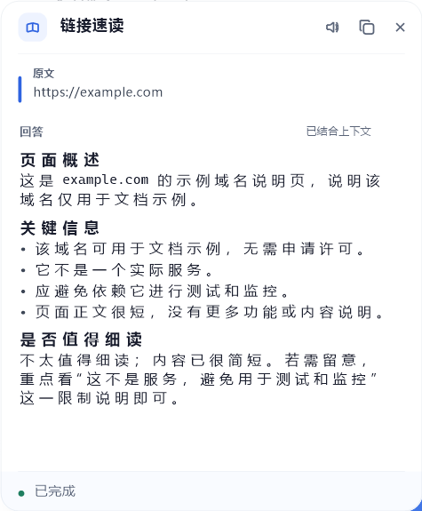

# 自定义技能：从零到能用

> 这一页讲三件事：**怎么加一个技能**、**提示词怎么写才听话**、**出问题看哪里**。
> 图文对应「设置 → 技能管理」那一页。

---

## 0. 三分钟上手

1. 打开 **设置 → 技能管理**，滚到列表底部，点 **「+ 添加技能」**。
2. 填四项：**名称** → **图标** → **提示词** → **结果落点**。
3. 点 **保存**。它立刻出现在卡片列表里。
4. 把它**拖到前 N 位**（N 由「常驻数量」决定，默认 5）——只有前 N 个会上浮条，其余在「更多」里。
5. 去任意应用里**划一段文字**，点浮条上那个技能，结果出现在回答窗口（或剪贴板）。

---

## 1. 先分清两种技能

| | 内置技能 | 自定义技能 |
|---|---|---|
| 有哪些 | 解释 / 总结 / 翻译 / 复制 / 朗读 / 搜索 | 你建的那些 |
| 提示词在哪 | 代码里的默认规则，**设置页 04 区**可改 | 你自己填 |
| 能否删除 | ❌ 不能，只能**停用**或排序 | ✅ 卡片右侧垃圾桶 |
| 走的通道 | 前三个进模型；后三个在本机完成 | 进模型 |

判断标准很简单：**需要模型「读懂了再输出」的，就是自定义技能**；只是「复制 / 朗读 / 打开搜索」的，用内置的。

---

## 2. 表单四项分别是什么

### 名称（≤ 12 字）

浮条上显示的就是它。**建议 2~5 字**：

- 浮条是横向的，名字越长整条越宽（每个全角字约占 15px）。
- 超过 12 字会被截断，浮条上还会被省略号吃掉。

好名字：`润色`、`译成英文`、`提取待办`、`代码审查`
坏名字：`帮我把选中的文字润色一下`（浮条会变成一条横幅）

### 图标（9 选 1）

`search` 🔍 / `copy` / `globe` 🌐 / `wand` ✨ / `book` 📖 / `list` ☰ / `sparkle` ✳ / `speak` 🔊 / `bolt` ⚡

只影响浮条与结果窗的标题图标，选个语义接近的就行。

### 提示词（真正的「技能」）

一段文本，就是发给模型的**全部内容**（没有系统提示、没有工具、没有对话历史）。所以它必须自带：

- 你要模型扮演什么 / 做什么
- 硬性要求（格式、长度、语气）
- 原文放哪（用 `{{text}}`）

上限 8000 字符。

### 结果落点

| | 用在什么场景 | 行为 |
|---|---|---|
| **回答窗口**（默认） | 解释、摘要、审查、邮件 | 流式显示，可滚动、可复制、可朗读，长得好看 |
| **剪贴板** | 搜索词、提交信息、短句改写 | 生成完自动复制，面板里也能看到 |

经验：**结果超过三行、需要阅读的 → 回答窗口；一两行、要立刻粘到别处的 → 剪贴板。**

---

## 3. 三个变量（模板的全部语法）

| 变量 | 内容 | 备注 |
|---|---|---|
| `{{text}}` | 你选中的文字 | 漏写会自动在末尾补一段「选中的文本」 |
| `{{context}}` | 选区**所在的段落** | 系统级划词用 UI Automation 读；读不到就是空串 |
| `{{lang}}` | 界面语言（`zh` / `en`） | 想让回答跟随界面语言时用 |

规则：

- 不认识的变量（比如 `{{foo}}`）会被**清空**，不会原样发给模型。
- 用了 `{{context}}` 一定要写一句「仅作语境，不要翻译/总结它」——否则模型会把上下文也一起处理。
- `{{context}}` 可能是空的（某些应用不暴露文本），提示词要能在没有上下文时也成立。

---

## 4. 提示词怎么写才听话

### 4.1 四段式

```
<身份 + 任务，一句话>

要求：
- <硬约束 1>
- <硬约束 2>
- <输出边界>

<原文标签>：
{{text}}
```

### 4.2 三个最容易踩的坑

**① 不写输出边界 → 模型爱加前言**

```
❌ 帮我总结这段话
✅ 用三行总结。要求：只输出三行，不要前言、不要解释你的思路。
```

**② 让模型「顺便」做太多**

一个技能只做一件事。「翻译并总结并提取关键词」的结果通常三样都平庸。需要多个动作，就建多个技能，浮条上一排。

**③ 把原文放进指令中间**

```
❌ 请把 {{text}} 翻译成英文，注意保留格式
✅ 把下面的内容翻译成英文。要求：保留格式。\n\n原文：\n{{text}}
```

原文放最后、用独立段落隔开，模型更不容易把指令和内容混在一起。

### 4.3 看一个完整的例子

「优化搜索词」的内置版本长这样（可以在设置里直接改）：

```
把选中的文字改写成 1~3 条更适合搜索引擎的查询词。

要求：
- 去掉口语与冗余修饰，保留专有名词，必要时补上限定词。
- 每行一条，只输出查询词，不要编号、不要解释。

原文：
{{text}}
```

它做对的四件事：说清任务、给了数量区间、规定了「每行一条」、明确禁止编号和解释。

---

## 5. 六个可以照抄的配方

完整的 8 个在 [`docs/custom-skills.samples.json`](custom-skills.samples.json)，可以直接粘进配置。这里挑三个最常用的讲。

### 5.1 译成英文（面板）

```
把选中的中文翻译成自然、地道的英文。

要求：
- 保留专有名词、代码、数字与原有格式。
- 只输出英文译文，不要解释、不要加引号、不要重复原文。
- 如果原文已经是英文，原样返回。

原文：
{{text}}
```

> 为什么要「如果已经是英文就原样返回」：划错行时不至于把英文再翻一遍。

### 5.2 提取待办（剪贴板）

```
从下面的文字里提取所有待办事项。

要求：
- 每条一行，格式「- 负责人：事项（截止时间）」，缺失的字段写「-」。
- 不要编号，不要总结，不要重复原文。
- 没有任何待办时只输出「无」。

原文：
{{text}}
```

> 剪贴板落点 + 固定格式 = 直接从会议记录里薅出任务清单，粘到待办工具里。

### 5.3 代码审查（面板）

```
你是资深工程师，审查选中的代码。

要求：
- 先用一句话说明这段代码做什么。
- 再分「问题」与「建议」两节，覆盖正确性、边界条件、性能、可读性。
- 每条尽量引用一小段代码来定位，不要整段复述。
- 除非必要不要重写整段代码；需要时只给改动的片段。

代码：
{{text}}
```

> 「不要整段复述」这条很重要：不写的话，模型会把你的 200 行代码抄一遍再评论。

其余五个（三行摘要 / 改写成邮件 / 提交信息 / 术语卡片 / 润色）见示例文件。

---

## 6. 两种导入方式

### 方式 A：在设置页手建（推荐新手）

「+ 添加技能」→ 把上面代码块整段粘进提示词框 → 保存。一次一个，边建边试。

### 方式 B：直接改配置文件（批量）

配置文件：`%DSH_HOME%\dsh-select-assist.json`（默认 `C:\Users\DELL\.dsh\dsh-select-assist.json`）。

把示例文件里的对象追加到 `skills` 数组：

```jsonc
{
  "toolbarEnabled": true,
  "topN": 5,
  "menuTimeoutMs": 15000,
  "skills": [
    /* 内置的那几个保留…… */
    { "id": "sk_todos", "name": "提取待办", "icon": "list", "kind": "prompt",
      "prompt": "从下面的文字里提取所有待办事项。……\n\n原文：\n{{text}}",
      "output": "clipboard", "enabled": true, "deletable": true }
  ]
}
```

保存后**不用重启**——伴生进程按文件修改时间热加载，下一次划词就是新的。宿主侧（设置页）刷新一下也能看到。

> ⚠️ 用记事本 / PowerShell 保存时注意编码：v0.11 起已经会**自动去掉 BOM**，但**不要**存成 UTF-16，那仍然解析不了。

---

## 7. 出问题看哪里

| 现象 | 原因 / 处理 |
|---|---|
| 点了技能，窗口一直「正在读取选区…」 | 该应用不暴露 UI Automation 且剪贴板兜底也失败。换个应用试试，或在设置里把「取词来源」留给默认（UIA 优先） |
| 窗口显示「生成失败 · …」 | 模型侧报错。看 `/api/dsh-select-assist/run` 的返回，通常是模型座位/网络 |
| 结果为空 | 模型什么都没输出。把提示词改短、把「只输出…」写明确 |
| 技能没出现在浮条上 | 它在第 N 个之后 → 去「更多」里；或被**停用**了（开关变灰） |
| 名称显示不全 | 名称超过 12 字被截断，或者浮条太宽被省略号吃掉 |
| 改了 JSON 没生效 | 检查文件是否**合法 JSON**（多余逗号最常见）；v0.11 已能容 BOM |
| 想要「复制/朗读/搜索」这类动作 | 用内置技能，自定义技能只走模型 |

调试用接口（本机）：

```powershell
# 伴生进程状态：取词来源、最近一次菜单决策、停留时长
curl http://127.0.0.1:<companionPort>/status
# 让浮条在指定坐标出现（不用真的划词）
curl -X POST http://127.0.0.1:<companionPort>/simulate -H "content-type: application/json" -d '{"text":"测试","x":700,"y":420}'
```

`<companionPort>` 在 `http://127.0.0.1:11514/api/dsh-select-assist/system/status` 里。

---

## 8. 链接：选中一个 URL 再点技能

如果选中的**整段文字就是一个 `http(s)://` 链接**，点自定义技能时伴生进程会先把页面抓下来，
把正文塞进 `{{context}}`，再交给模型——模型自己打不开网页，没有这一步它只能对着 URL 猜。

所以写「读链接」类技能时，正文用 `{{context}}`：

```
我选中了一个链接：
{{text}}

下面是这个页面的正文：
{{context}}

请根据正文回答：
1. 一句话说明这个页面在讲什么。
2. 3~5 条关键信息。
3. 是否值得细读；值得的话指出最该看的部分。

如果正文为空，直接说「没能读取到页面内容」，只根据链接本身推测它大概是什么页面，不要编造正文细节。
```

「链接速读」技能就是这么写的，效果：



抓取的边界（都是刻意的）：

| 限制 | 值 / 行为 |
|---|---|
| 只认「整段就是一个链接」 | 一段话里夹着链接不算（那时 `{{text}}` 是整段话，不是 URL） |
| 协议 | 只有 `http` / `https` |
| 本机与内网 | **拒绝**（`localhost`、`127.*`、`10.*`、`192.168.*`、`172.16–31.*`、`169.254.*`、`fc00::` 等），域名解析到内网也拒绝 |
| 超时 | 8 秒，超时按"没读到"处理 |
| 正文长度 | 最多 4000 字符（与宿主侧上限一致，超出会被截断） |
| 内容类型 | 只处理 html / 纯文本 / xml；PDF、图片直接放弃 |
| 生效范围 | **只对自定义技能抓**；内置的解释/翻译/总结仍按原文处理 |
| 抓不到的页面 | 纯 JS 渲染的 SPA、要登录、付费墙、反爬 —— 面板会显示"没能读取到页面内容"，不会编造 |

调试：`/status` 里的 `lastLink` 会写清"抓没抓到、多少字符、什么原因失败"。

---

## 9. 排序、常驻、停用

- **拖拽卡片**调整顺序；顺序就是浮条顺序。
- **常驻数量**（topN）含「更多」：设为 5 时，浮条上是 4 个技能 + 1 个「⋯」。
- 浮条放不下（屏幕窄 / 名字长）会自动继续往「更多」里挤，至少保留一个。
- 卡片右侧的**开关**只是停用，不删除；停用的不占位置。
- 内置技能不能删（右侧是「·」而不是垃圾桶），但可以停用、可以拖到最后。

---

## 10. 备份与分享

你的全部自定义技能都在 `skills` 数组里。想分享给别人：

1. 设置页看不到「导出」——直接从 `dsh-select-assist.json` 里把 `skills` 中 `deletable: true` 的那些复制出来；
2. 对方的 `id` 不要重复（建议保留 `sk_` 前缀 + 英文短名）；
3. 对方粘进自己的 `skills` 数组即可，`id` 冲突的会被丢弃。

---

## 11. 一页速查

```
名称   2~5 字（≤12）
图标   9 选 1
提示词 身份 + 要求 + 原文（{{text}} / {{context}} / {{lang}}）
落点   长结果 → 面板；短结果 → 剪贴板
生效   保存即生效，划词可试
调试   /status 看取词与菜单；/simulate 免手划
```
